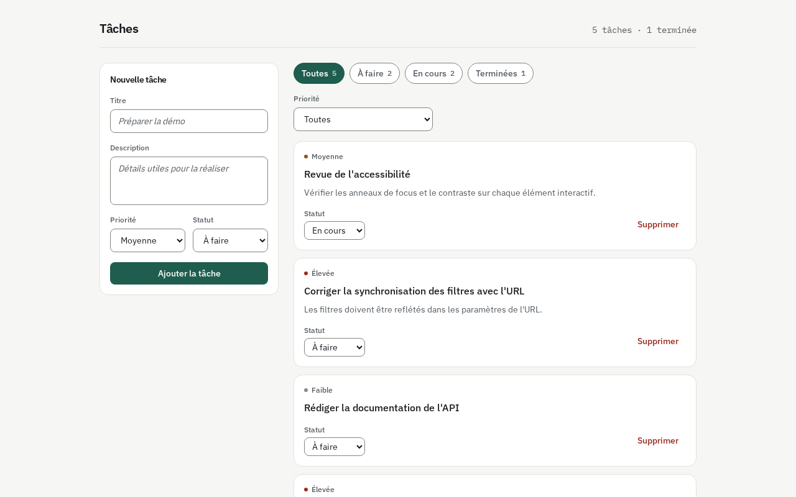
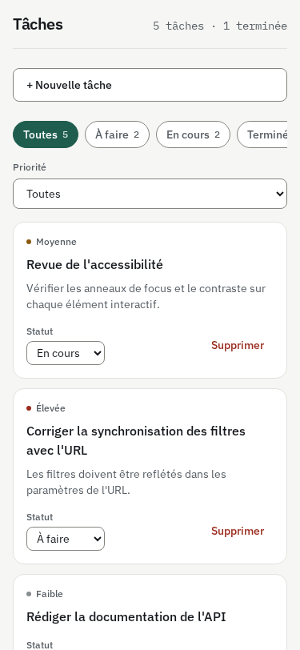

# Task Manager

Petit gestionnaire de tâches : liste, création, changement de statut, suppression et filtrage, avec rendu côté serveur. Réalisé dans le cadre d'un test technique.

|                     Bureau (1280px)                     |                   Mobile (375px)                    |
| :-------------------------------------------------------: | :----------------------------------------------------: |
|                 |               |

## Sommaire

- [Prérequis](#prérequis)
- [Installation et lancement](#installation-et-lancement)
- [Base de données](#base-de-données)
- [Architecture](#architecture)
- [API](#api)
- [Choix techniques et compromis](#choix-techniques-et-compromis)
- [Fonctionnalités](#fonctionnalités)
- [Pistes d'amélioration](#pistes-damélioration)

## Prérequis

- Node.js 22.22+ ou 24.15+ (contrainte posée par `@nuxt/nitro-server`, voir `engines` dans `package.json` ; `.nvmrc` fixe la version 24.15)
- npm (fourni avec Node)

## Installation et lancement

```bash
git clone https://github.com/Dyloow/task-manager.git
cd task-manager
npm install
```

`npm install` déclenche `nuxt prepare` (script `postinstall`) qui génère les types Nuxt.

### Développement

```bash
npm run dev
```

L'application est servie sur `http://localhost:3000`.

### Production

```bash
npm run build
npm run preview
```

`build` compile l'application dans `.output/`, `preview` sert ce build localement. Le stockage utilisant un chemin relatif, les données du build servi en `preview` vivent dans `.output/.data/tasks/list`, distinctes de celles de `npm run dev` (`.data/tasks/list`) : elles repartent du seed à chaque `npm run build`.

### Vérifications

```bash
npm run typecheck   # vue-tsc, sans émission
npm test            # les trois projets Vitest (unit, nuxt, e2e)
```

Un projet de tests peut être lancé isolément :

```bash
npx vitest run --project unit
npx vitest run --project nuxt
npx vitest run --project e2e
```

## Base de données

Pas de base de données : hors périmètre de l'exercice. Les tâches sont persistées dans un fichier JSON via le stockage Nitro (driver `fs`, voir `nitro.storage.tasks` dans `nuxt.config.ts`), sous `.data/tasks/`. L'accès ne passe jamais directement par ce fichier : tout transite par le dépôt de tâches (`server/utils/task-repository.ts`), dont les écritures sont sérialisées sur une file unique pour que deux requêtes concurrentes ne s'écrasent pas.

- **Initialisation** : au premier appel, si la clé `list` est absente du stockage, elle est amorcée depuis `server/data/tasks.json` (jeu de données de démonstration), puis écrite dans `.data/tasks/list`.
- **Réinitialisation** : supprimer le dossier `.data/tasks` (ou `.data` entier) puis recharger l'application ; les données de démonstration sont réécrites automatiquement au prochain accès.

  ```bash
  rm -rf .data
  npm run dev
  ```

- **Donnée corrompue** : toute lecture passe par le même dépôt de tâches, donc si le contenu stocké ne respecte pas le schéma Zod d'une tâche (édition manuelle du fichier, par exemple), chaque route (`GET`, `POST`, `PATCH`, `DELETE`) répond `500` avec le message « Task data is corrupted », sans jamais écraser le fichier existant : la donnée invalide reste disponible pour investigation, le détail de l'erreur est loggé côté serveur et jamais renvoyé au client.

## Architecture

```
app/
├── pages/index.vue          page unique : liste, filtres, formulaire de création
├── components/               composants présentationnels (carte, filtres, formulaire, alertes)
├── composables/               synchronisation des filtres avec l'URL
├── stores/tasks.ts            état Pinia : liste, filtres, erreurs, mises à jour optimistes
├── utils/                     libellés français des énumérations, normalisation des erreurs API
└── assets/css/main.css        jetons Tailwind (@theme)

server/
├── api/tasks/                 routes Nitro (une par méthode HTTP)
├── utils/task-repository.ts   lecture/écriture du fichier, file d'écriture sérialisée
└── data/tasks.json            jeu de données de démonstration (seed)

shared/
├── types/task.ts              types TypeScript dérivés des schémas
└── schemas/task.ts            schémas Zod, contrat unique utilisé par le client et le serveur

test/
├── unit/                      logique serveur et schémas, Node pur
├── nuxt/                      store, composables, composants (environnement Nuxt)
└── e2e/                       API complète sur un serveur réel, stockage en mémoire
```

Flux d'une requête : `page → store (action Pinia) → $fetch → route serveur → dépôt de tâches → fichier JSON`. Le chargement initial de la liste s'exécute côté serveur via `useAsyncData`, qui hydrate directement le store depuis le payload SSR : aucun second appel réseau n'a lieu au montage côté client.

## API

Base `/api`, JSON, sans versionnage. Le serveur génère `id`, `createdAt` et `updatedAt` ; le client ne les envoie jamais.

| Méthode  | Route            | Succès | Erreurs                                      |
| -------- | ---------------- | ------ | --------------------------------------------- |
| `GET`    | `/api/tasks`      | `200` liste des tâches | `500` donnée corrompue                |
| `POST`   | `/api/tasks`      | `201` tâche créée      | `400` corps invalide                  |
| `PATCH`  | `/api/tasks/:id`  | `200` tâche mise à jour | `400` corps invalide · `404` id inconnu |
| `DELETE` | `/api/tasks/:id`  | `204` sans contenu     | `404` id inconnu                      |

Un `400` levé après l'analyse du corps (champ invalide, manquant...) renvoie le détail de validation Zod dans `data.issues` (`fieldErrors` par champ, `formErrors` globaux). Un `400` levé avant, parce que le corps n'est pas un JSON valide, n'a pas ce détail : il vient de `h3` lui-même (`readBody`), pas du schéma. Toute erreur est levée avec `createError` (`h3`), donc reçue côté client comme `{ statusCode, statusMessage, data }`.

## Choix techniques et compromis

| Choix                                                                 | Pourquoi / compromis                                                                 |
| ---------------------------------------------------------------------- | -------------------------------------------------------------------------------------- |
| Chargement initial côté serveur (`useAsyncData` + Pinia)                | Le premier rendu est déjà peuplé, pas de flash de chargement ; le store est réhydraté depuis le payload SSR, jamais refetché au montage client |
| File d'écriture unique dans le dépôt de tâches                          | Lecture-modification-écriture atomique au sein d'un même processus Node ; ne protège pas une donnée partagée entre plusieurs instances (déploiement multi-process ou serverless), limite assumée vu le stockage fichier |
| Validation Zod à chaque lecture du fichier, pas seulement à l'écriture  | Détecte un fichier corrompu ou édité à la main avant de le renvoyer au client, au prix d'un `safeParse` sur chaque requête |
| Mise à jour de statut et suppression optimistes, création pessimiste    | Statut et suppression sont des issues prévisibles : l'UI répond immédiatement et annule la mutation localement en cas d'échec (rollback ciblé : seulement si rien d'autre n'a écrit entre-temps) ; la création attend le serveur, qui seul génère l'identifiant |
| Erreurs normalisées en un objet `ApiErrorState` sérialisable             | Une instance de classe ne survit pas à la sérialisation du payload SSR (`devalue`) ; chaque action du store porte son propre message utilisateur en français, découplé du message HTTP brut |
| Filtres portés par l'URL (`useTaskFilters`), un seul sens de synchronisation | La query string est la source de vérité : un watcher unique la pousse vers le store, jamais l'inverse ; une vue filtrée reste partageable et rechargeable (détail de l'historique sous le tableau) |
| Composants de présentation (props/emit), seule la page parle au store   | Composants testables et réutilisables indépendamment de Pinia |
| Tailwind v4 seul, jetons déclarés avec `@theme`                         | Pas de bibliothèque de composants ; palette et rayons centralisés dans `app/assets/css/main.css` |
| Interface en français, code et valeurs d'énumération en anglais         | Le public visé est francophone ; les identifiants restent des clés stables côté code |
| Suppression confirmée par un second clic (auto-annulé après 4 s) plutôt qu'une modale | Évite une suppression accidentelle sans ajouter de composant modal |
| Trois projets de tests (unit / nuxt / e2e)                              | Unit pour la logique serveur et les schémas en Node pur, nuxt pour le store et les composants avec `$fetch` mocké, e2e sur un serveur réel avec stockage en mémoire (dont un test de 20 requêtes concurrentes) ; aucun test de navigateur (Playwright) n'est en place |
| Pas de base de données, pas d'authentification, pas de backend séparé   | Hors périmètre de l'exercice (budget de 3 à 4 heures) |

Historique des filtres : chaque changement de filtre fait un `router.push`, donc `Précédent` revient au filtre précédent. La réinitialisation efface statut et priorité en un seul `push`, pour ne pas créer d'étape intermédiaire. La correction d'une valeur invalide dans l'URL fait un `replace` : ce n'est pas une navigation à annuler.

## Fonctionnalités

- [x] Liste des tâches chargée côté serveur au premier rendu (SSR)
- [x] Création d'une tâche (titre, description, statut, priorité), validée côté client et côté serveur
- [x] Changement de statut d'une tâche
- [x] Suppression d'une tâche (confirmation par second clic)
- [x] Filtrage par statut et par priorité, reflété dans l'URL
- [x] Interface responsive (mobile et bureau), Tailwind uniquement
- [x] Retours d'erreur explicites : échec de chargement (avec reprise), échec de mutation (bannière + annulation), erreurs de champ en ligne
- [x] Notification quand une tâche créée est masquée par les filtres actifs, avec une action pour tout afficher

## Pistes d'amélioration

- Édition du titre et de la description d'une tâche existante
- Base de données réelle avec transactions, pour un déploiement multi-instance
- Authentification
- Pagination et recherche
- Réorganisation par glisser-déposer
- Tests de navigateur de bout en bout (Playwright)
- Internationalisation (l'interface est figée en français)
- Suppression par notification (toast) avec annulation, au lieu d'une confirmation par second clic
- Intégration continue (CI)
