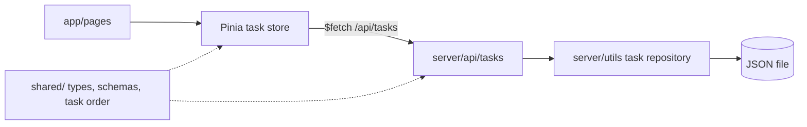

# Architecture

## Stack

- TypeScript everywhere, Nuxt full-stack: Vue app in `app/`, Nitro server routes in `server/`.
- Pinia (`@pinia/nuxt`) for client state, Tailwind CSS (Vite plugin) for every style.
- Zod validates every payload entering a server route.

## How it fits together

## Key decisions

- Initial load runs on the server via `useAsyncData` calling the store action, so the store is hydrated in the SSR payload, not refetched on the client.
- Types, Zod schemas and the per-column ordering algorithm (`columnOf`/`assignColumnPositions`/`applyMove`) live once in `shared/` and are imported by both app and server: one contract, no drift.
- The server is the source of truth. Mutations split by how safely they can be undone: deleting is optimistic with a targeted rollback (the one task, reinserted); a drag-and-drop move is optimistic too, but a failure resyncs the whole board from the server instead of a targeted rollback (a move rewrites ranks across two columns); creating and editing a task are pessimistic, waiting for the server so a field-level `400` can be reported before anything changes.
- Writes to the JSON file are serialized through a single queue to keep the file consistent under concurrent requests.
- No separate backend nor database, by brief.

## Gotchas

- Code under `server/` never imports from `app/`, and `app/` never imports from `server/`; share through `shared/`.
- A store must not hold state at module level: on the server it would leak between requests. Use `defineStore` state only.
- `$fetch` inside SSR calls the route in-process; relative URLs work on both sides.
