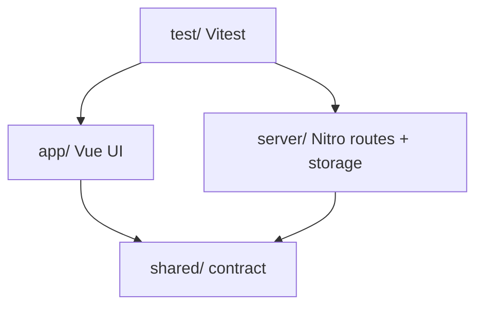

# Codebase Map

## Areas

- `app/`: pages, components, composables, Pinia stores, Tailwind entry CSS (`app/assets/css/main.css`).
- `server/api/`: HTTP routes, one file per method (`index.get.ts`, `[id].patch.ts`...).
- `server/utils/`: task repository (file read/write, write queue), auto-imported by Nitro.
- `server/data/`: seed JSON used to initialize the data file.
- `shared/`: task types and Zod schemas shared by app and server.
- `test/unit/`: pure Node tests (server logic, schemas). `test/nuxt/`: tests needing the Nuxt runtime (stores, components).

## Entry points

- `app/app.vue` renders the app, `nuxt.config.ts` wires modules, CSS and Vite plugins.
- `server/api/tasks/*` is the only server surface.
