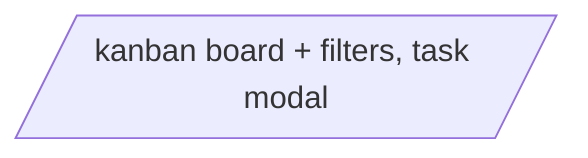

# Navigation

## Routing

- Nuxt file-based routing in `app/pages/`; no auth, all routes public.
- Filters are reflected in the URL query so a filtered view can be shared and reloaded. The status filter selects which board column(s) render, not a row filter; the priority filter narrows the cards within each rendered column.

## Structure

