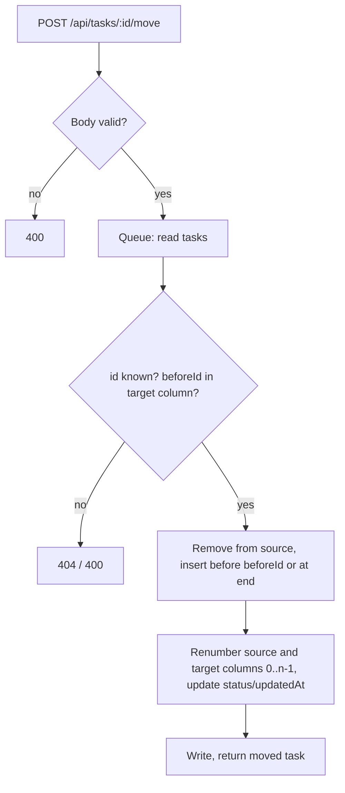
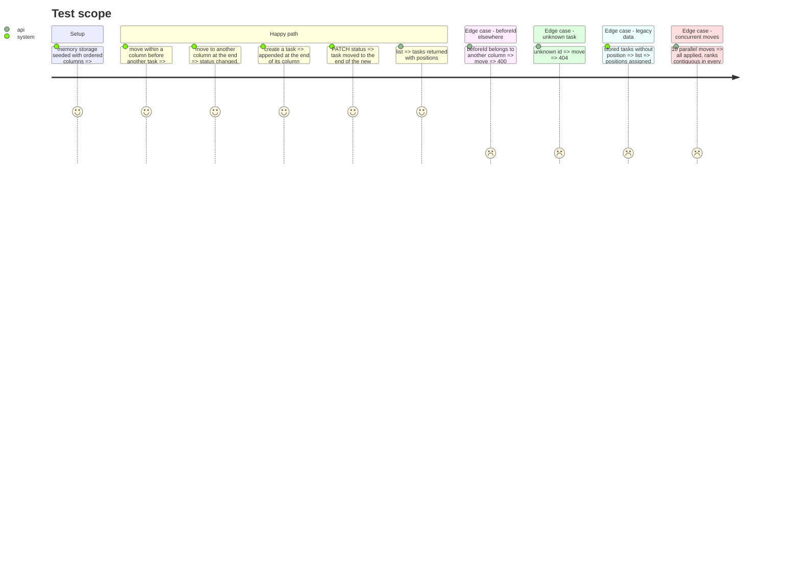

# Instruction: Persisted position and move endpoint

## Architecture projection

```txt
.
├── shared/schemas/task.ts              ✏️ `position` (int ≥ 0) on task; moveTaskSchema { status, beforeId: string | null }
├── shared/types/task.ts                ✏️ MoveTaskInput
├── server/utils/task-repository.ts     ✏️ normalize missing positions on read; create appends to column end; status change via update moves to end of target column; move(id, { status, beforeId })
├── server/api/tasks/[id]/move.post.ts  ✅ validate, move, 200 with the moved task (404 unknown id, 400 invalid body or beforeId not in target column)
├── server/api/tasks/[id].patch.ts      ✏️ (route path unchanged, only if folder move requires it)
├── server/data/tasks.json              ✏️ add positions to the seed
└── test/
    ├── unit/server/task-repository.test.ts ✏️ ordering, move cases, normalization
    └── e2e/tasks-api.test.ts               ✏️ move route contract + concurrency
```

## User Journey



## Test Scope



## Tasks to do

### `1)` Contract

1. Add `position` to `taskSchema`; `createTaskSchema`/`updateTaskSchema` never accept it from clients.
2. `moveTaskSchema`: strict `{ status, beforeId: string | null }`.

### `2)` Repository

1. Normalize on read: missing positions assigned per status by `createdAt`; then always return tasks sorted by status then position.
2. `create`: position = column length. `update` with a status change: append to target column and renumber the source column.
3. `move(id, input)`: inside the queue; `null` for unknown id; a typed error for `beforeId` not found in the target column (route maps it to 400); renumber both columns.
4. `remove`: renumber the column.

### `3)` Route and tests

1. `server/api/tasks/[id]/move.post.ts` reusing `parseBody`.
2. Unit and e2e tests for the Test Scope.

## Test acceptance criteria

| Task | Acceptance criteria |
| ---- | ------------------- |
| 1    | Clients cannot set `position` through create or update (400) |
| 2    | After any mutation, each column's positions are exactly 0..n-1; legacy data loads |
| 3    | Move route answers 200/400/404 as documented; 10 concurrent moves keep ranks contiguous |
