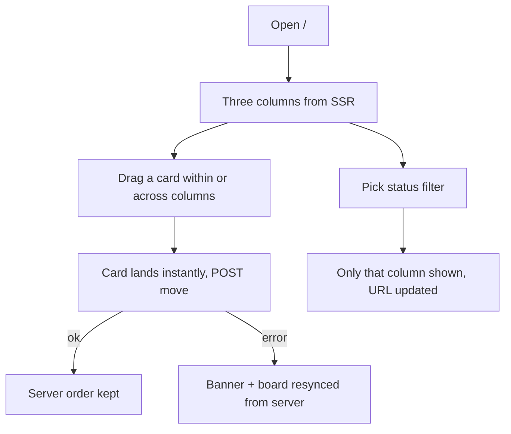
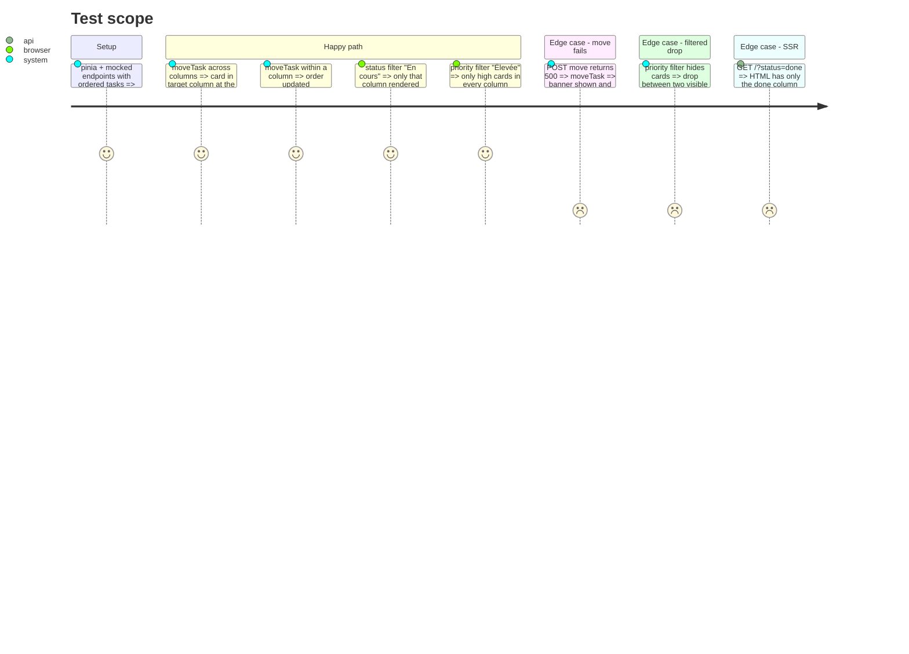

# Instruction: Board, drag and drop, store moves

## Architecture projection

```txt
.
├── package.json                        ✏️ add vue-draggable-plus (+ sortablejs types if needed)
├── app/stores/tasks.ts                 ✏️ tasksByStatus getter (ordered by position, priority filter applied), moveTask(id, status, beforeId) optimistic, resync on failure; French error message for move
├── app/components/
│   ├── TaskBoard.vue                   ✅ columns layout, horizontal snap scroll on mobile
│   ├── TaskColumn.vue                  ✅ header (label + count), draggable list, "+ Ajouter une tâche", empty drop zone
│   ├── TaskCard.vue                    ✏️ compact card (title, priority, description excerpt), click/Enter opens the modal, drag handle semantics
│   ├── TaskFilters.vue                 ✏️ status buttons select visible columns, priority select filters cards
│   └── TaskList.vue                    ❌ replaced by the board
├── app/pages/index.vue                 ✏️ board instead of list + sidebar form
└── test/nuxt/...                       ✏️ store move tests, board/column tests, page journey updated
```

## User Journey



## Test Scope



## Wireframe

```txt
Desktop
┌───────────────────────────────────────────────────────────────────────────────┐
│ Tâches                               [+ Nouvelle tâche]    6 tâches · 2 term. │
│ [Toutes 6][À faire 2][En cours 2][Terminées 2]          Priorité [Toutes ▾]   │
├─────────────────────────┬─────────────────────────┬───────────────────────────┤
│ À faire            2    │ En cours           2    │ Terminées          2      │
│ ┌─────────────────────┐ │ ┌─────────────────────┐ │ ┌───────────────────────┐ │
│ │ ● Élevée            │ │ │ ● Moyenne           │ │ │ ● Moyenne             │ │
│ │ Corriger la synchro │ │ │ Revue accessibilité │ │ │ ~~Initialiser dépôt~~ │ │
│ │ Les filtres doivent…│ │ │ Vérifier les anneau…│ │ └───────────────────────┘ │
│ └─────────────────────┘ │ └─────────────────────┘ │                           │
│ + Ajouter une tâche     │ + Ajouter une tâche     │ + Ajouter une tâche       │
└─────────────────────────┴─────────────────────────┴───────────────────────────┘
Mobile: columns ~85vw wide, horizontal scroll with snap, next column peeking.
```

## Tasks to do

### `1)` Store

1. `tasksByStatus` getter: per status, sorted by position, priority filter applied.
2. `moveTask(id, status, beforeId)`: optimistic local reorder mirroring the server rules, pending tracking, `POST /api/tasks/:id/move`; on failure: banner message « Impossible de déplacer la tâche. Le tableau a été resynchronisé. » and `fetchTasks()`.
3. `updateStatus` and `createTask` keep working with positions (append to column end locally).

### `2)` Board components

1. `vue-draggable-plus` lists sharing one group across columns; on drop compute `beforeId` from the full column order (next task in the target column after the drop, ignoring hidden ones), call the page handler.
2. Keyboard alternative: status remains changeable from the modal (phase 3); cards are focusable buttons.
3. Columns: label, count, empty drop zone, « + Ajouter une tâche » emits create with the column status.
4. Responsive: grid of 3 on desktop; mobile horizontal `snap-x` scroll.
5. SSR-safe: the board renders server-side; DnD activates on the client.

### `3)` Tests

1. Store move tests, filtered-drop `beforeId` test, board/column component tests, SSR test for the status filter, page journey updated.

## Test acceptance criteria

| Task | Acceptance criteria |
| ---- | ------------------- |
| 1    | A failed move leaves the board equal to the server's list, with a French banner |
| 2    | Drag across and within columns works with mouse and touch; order survives a reload |
| 3    | typecheck, tests and build pass |
