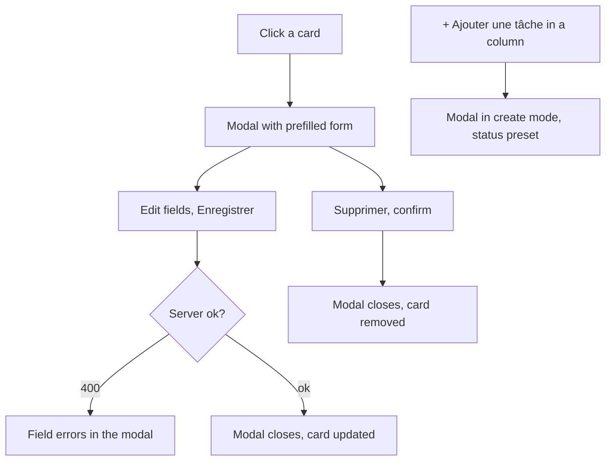
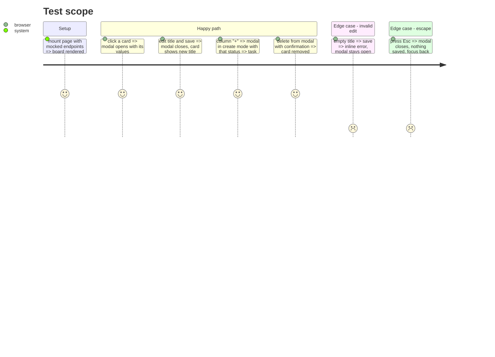

# Instruction: Task modal, docs and memory

## Architecture projection

```txt
.
├── app/components/
│   ├── TaskModal.vue        ✅ native <dialog>: create or edit mode
│   └── TaskForm.vue         ✏️ reused inside the modal, edit mode prefilled, title/description/priority/status
├── app/stores/tasks.ts      ✏️ updateTask(id, patch) pessimistic with field errors (title/description/priority; status change keeps column rules)
├── app/pages/index.vue      ✏️ open modal on card click, "+ Nouvelle tâche" and column "+" (status preselected)
├── README.md                ✏️ board, DnD, move endpoint, position, modal, updated screenshots and trade-offs
├── docs/screenshots/*.png   ✏️ new captures
└── aidd_docs/memory/*.md    ✏️ api.md (move route), database.md (position, normalization), design.md, navigation.md
```

## User Journey



## Test Scope



## Tasks to do

### `1)` Modal

1. `<dialog>` opened with `showModal()`, labelled by its title, Esc and backdrop close, focus returns to the trigger.
2. Create and edit modes share `TaskForm`; edit sends only changed fields; delete with second-click confirmation inside the modal.

### `2)` Store

1. `updateTask(id, patch)`: waits for the server, returns field errors on 400, French banner on other failures.

### `3)` Docs and memory

1. README sections updated (features, API table with move route, data model `position`, legacy normalization, DnD library choice, modal, trade-offs, improvements), new screenshots desktop + mobile, no mention of AI tools.
2. Memory files updated to match the code.

## Test acceptance criteria

| Task | Acceptance criteria |
| ---- | ------------------- |
| 1    | Every Test Scope line observable; modal is keyboard usable |
| 2    | A 400 keeps the modal open with field errors |
| 3    | README and memory match the shipped behavior; typecheck, tests, build pass |
