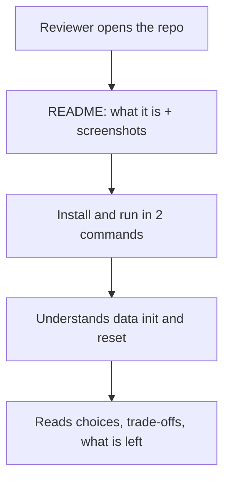
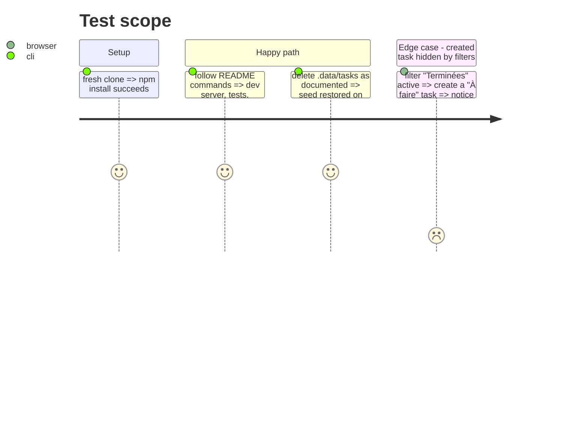

# Instruction: README, screenshots, last fix

## Architecture projection

```txt
.
├── README.md                              ✏️ replace the Nuxt starter README (French)
├── docs/screenshots/desktop.png           ✅ 1280px capture
├── docs/screenshots/mobile.png            ✅ 375px capture
├── app/pages/index.vue                    ✏️ notice when a created task is hidden by filters
└── test/nuxt/pages/index.test.ts          ✏️ cover that notice
```

## User Journey



## Test Scope



## Tasks to do

### `1)` README (French)

> Answer every point the brief asks for.

1. Presentation + screenshots.
2. Prerequisites (Node version from `node -v` used here, npm), install, run (`dev`, `build` + `preview`), tests (`test`, per-project), typecheck.
3. "Base de données": no DB by brief; JSON file through Nitro storage in `.data/tasks/list`, seeded from `server/data/tasks.json` on first read, reset by deleting `.data/tasks`, corrupted file → 500, never overwritten.
4. Architecture: folders map, data flow (page → store → `$fetch` → server route → repository → file), shared Zod contract, API table (method, path, codes, error shape).
5. Technical choices and trade-offs: SSR via `useAsyncData` + Pinia payload; single serialized queue (single-process limit, not for multi-instance/serverless); validation on read; optimistic status/delete with targeted rollback vs pessimistic create; serializable store error state; URL as source of truth for filters (`push` vs `replace`); presentational components; Tailwind tokens with `@theme`; French UI / English code; delete on second click; tests strategy (unit / nuxt / e2e with in-memory storage).
6. Features done (checklist mirroring the brief) and improvements left (edit title/description, real DB with transactions, auth, pagination/search, drag and drop, e2e browser tests with Playwright, i18n, toast undo instead of confirm, CI).
7. No mention of any AI tool. Do not describe `.claude/` or the AI tooling; `aidd_docs/` may be described as design notes and implementation plans.

### `2)` Screenshots

> Show the result without running it.

1. Capture 1280px and 375px with headless Chromium run from a scratch directory (no new project dependency), seed data only.

### `3)` Hidden created task notice

> Close the last review gap.

1. After a successful create, if the new task does not match active filters, show a short inline notice (« Tâche créée, masquée par les filtres actifs. » + « Tout afficher » resetting filters).
2. Page test for it.

## Test acceptance criteria

| Task | Acceptance criteria                                                      |
| ---- | ------------------------------------------------------------------------ |
| 1    | Every brief item (install/run, DB init, choices/trade-offs, done/left) has a section; commands are copy-paste correct |
| 2    | Both screenshots render in the README on GitHub                            |
| 3    | Notice appears only when the created task is filtered out; typecheck, tests, build pass |
