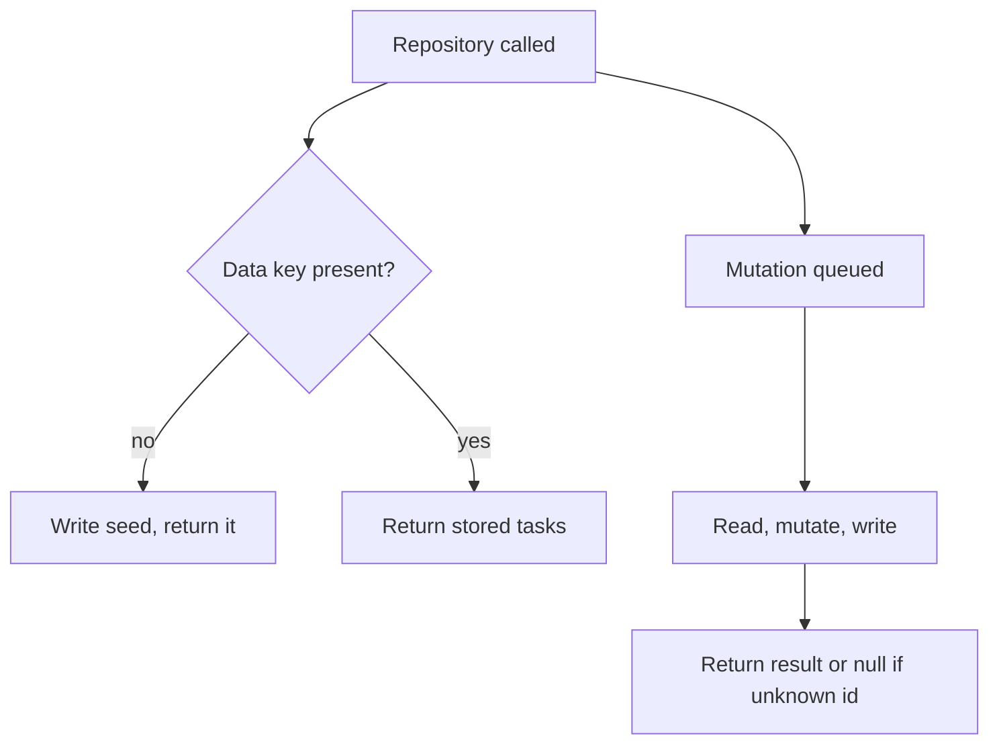
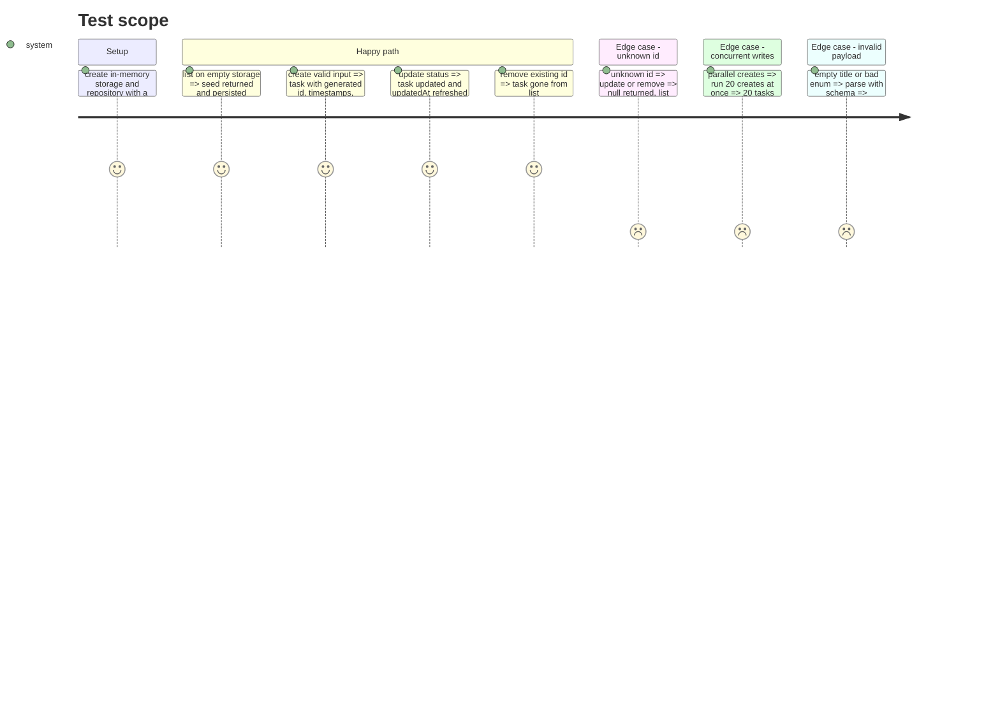

# Instruction: Shared contract and task repository

## Architecture projection

```txt
.
├── nuxt.config.ts                     ✏️ mount `tasks` storage (fs driver, base .data/tasks)
├── shared/
│   ├── types/task.ts                  ✅ Task, TaskStatus, TaskPriority, CreateTaskInput, UpdateTaskInput (inferred from schemas)
│   └── schemas/task.ts                ✅ Zod: status/priority enums, task, create, update (partial, at least one field)
├── server/
│   ├── data/tasks.json                ✅ seed (a handful of varied tasks)
│   └── utils/task-repository.ts       ✅ createTaskRepository(storage, seed): list, create, update, remove; serialized writes
└── test/unit/
    ├── smoke.test.ts                  ❌ replaced by real tests
    ├── shared/task-schema.test.ts     ✅
    └── server/task-repository.test.ts ✅
```

## User Journey



## Test Scope



## Tasks to do

### `1)` Shared contract

> One source of truth for task shape and validation.

1. Zod enums `taskStatusSchema` (`todo`, `in_progress`, `done`) and `taskPrioritySchema` (`low`, `medium`, `high`).
2. `createTaskSchema`: trimmed title 1..120, description trimmed max 1000 default `''`, status default `todo`, priority default `medium`.
3. `updateTaskSchema`: partial of create, strict, refined to require at least one field.
4. Export inferred types from `shared/types/task.ts`.

### `2)` Repository

> Persist tasks consistently in one storage key.

1. `createTaskRepository(storage, seed)` with `list`, `create`, `update(id, patch)`, `remove(id)`.
2. Seed on first read when the key is absent.
3. Chain every mutation on one promise queue; a failed mutation must not break the queue.
4. Generate ids with `crypto.randomUUID()`, ISO timestamps.
5. Export a `useTaskRepository()` helper binding `useStorage('tasks')` and the seed for routes.

### `3)` Storage mount and seed

> Data survives restarts and resets by deleting `.data/`.

1. Mount `tasks` storage in `nuxt.config.ts` (fs driver, base `.data/tasks`).
2. Add `server/data/tasks.json` seed covering every status and priority.

### `4)` Unit tests

> Prove the scope above.

1. Schema tests: defaults, trimming, invalid enums, empty update.
2. Repository tests on unstorage memory driver, including concurrency.

## Test acceptance criteria

| Task | Acceptance criteria                                                          |
| ---- | ---------------------------------------------------------------------------- |
| 1    | Invalid title, enum, or empty update is rejected with field-level issues      |
| 2    | 20 parallel creates leave exactly 20 more tasks; unknown id yields null       |
| 3    | Running the app creates `.data/tasks/` holding the seeded list                |
| 4    | `npm test` and `npm run typecheck` pass                                       |
