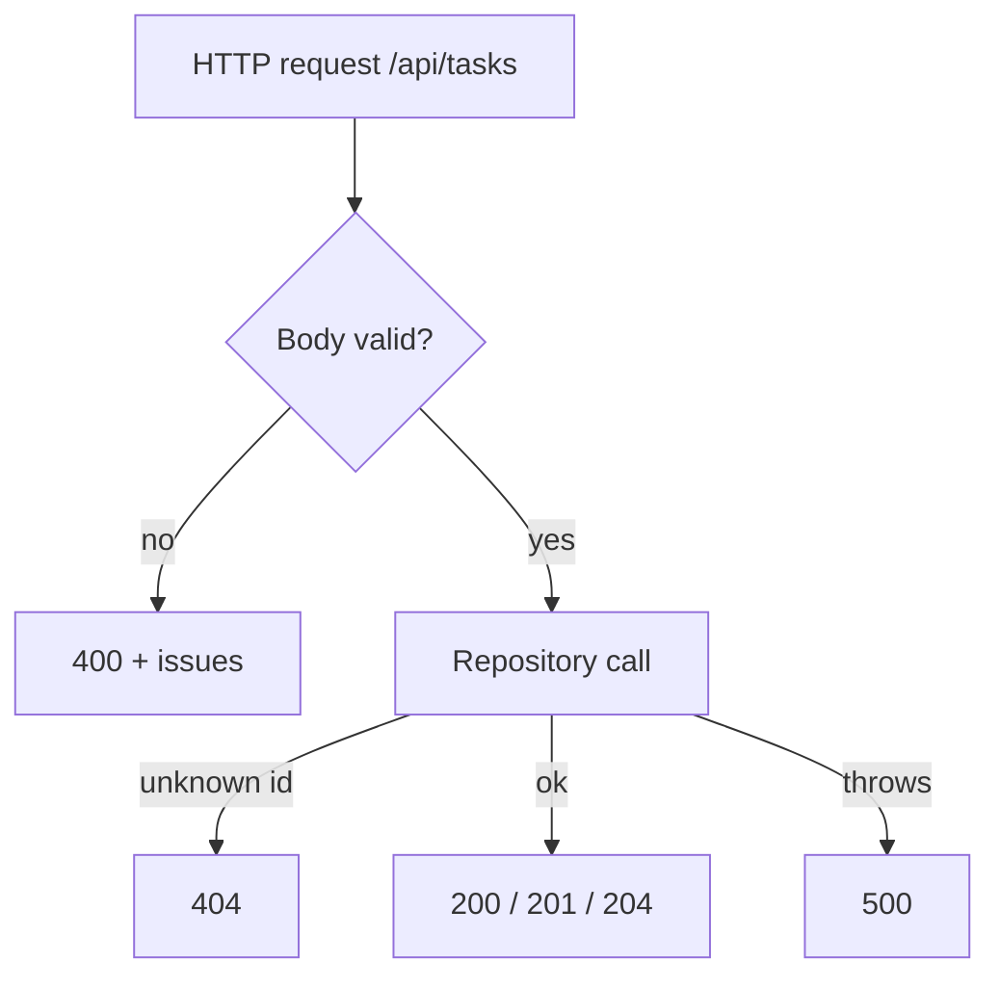
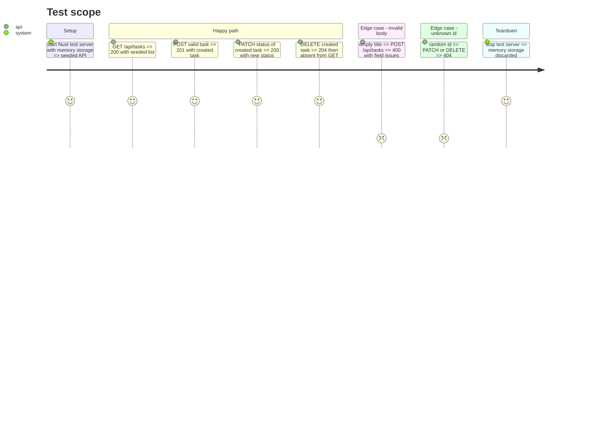

# Instruction: CRUD server routes and API tests

## Architecture projection

```txt
.
├── server/
│   ├── api/tasks/
│   │   ├── index.get.ts        ✅ list tasks
│   │   ├── index.post.ts       ✅ validate body, create, 201
│   │   ├── [id].patch.ts       ✅ validate body, update, 404 if unknown
│   │   └── [id].delete.ts      ✅ remove, 204, 404 if unknown
│   └── utils/validation.ts     ✅ parseBody(event, schema): throws 400 with flattened Zod issues in data
├── vitest.config.ts            ✏️ add `e2e` project
└── test/e2e/tasks-api.test.ts  ✅ real HTTP calls against a built Nuxt server with in-memory storage
```

## User Journey



## Test Scope



## Tasks to do

### `1)` Validation helper

> One way to turn a bad body into a 400.

1. `parseBody` reads the body, `safeParse`s it, throws `createError({ statusCode: 400, statusMessage, data: { issues } })`.

### `2)` Routes

> Thin handlers: parse, call repository, map result to status.

1. GET returns the list.
2. POST sets 201 and returns the created task.
3. PATCH and DELETE read `id` via `getRouterParam`, 404 when the repository returns null; DELETE sets 204.
4. Unexpected errors bubble to Nitro as 500 without leaking internals.

### `3)` API tests

> Exercise real HTTP contracts.

1. Add `e2e` Vitest project (node env, longer timeout).
2. `setup()` from `@nuxt/test-utils/e2e` with `nitro.storage.tasks` overridden to the memory driver.
3. Cover the Test Scope journey.

## Test acceptance criteria

| Task | Acceptance criteria                                                        |
| ---- | -------------------------------------------------------------------------- |
| 1    | Invalid body returns 400 whose `data.issues` names the offending field      |
| 2    | Each route answers with the documented status code and body                 |
| 3    | `npm test` runs unit and e2e projects green; typecheck and build pass       |
