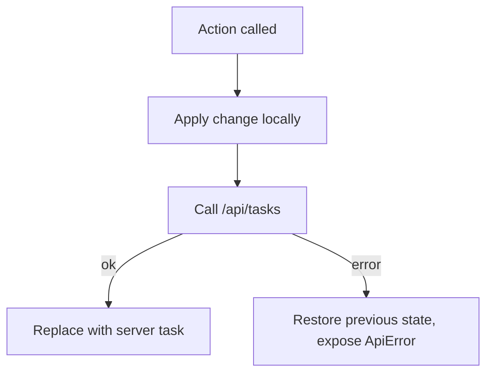
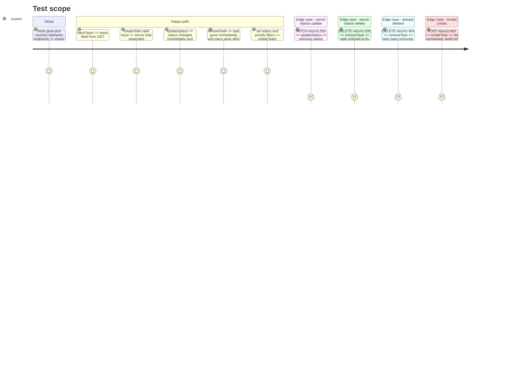

# Instruction: Task store with optimistic mutations

## Architecture projection

```txt
.
├── app/
│   ├── utils/api-error.ts          ✅ toApiError(error): ApiError from a FetchError (400 issues, 404, 500, network)
│   └── stores/tasks.ts             ✅ useTasksStore (setup store): state, getters, actions
└── test/nuxt/
    ├── smoke.test.ts               ❌ replaced by real tests
    ├── utils/api-error.test.ts     ✅
    └── stores/tasks.test.ts        ✅ actions against endpoints mocked with registerEndpoint
```

## User Journey



## Test Scope



## Tasks to do

### `1)` API error normalization

> One error shape for every failed call.

1. `ApiError { statusCode, message, fieldErrors, formErrors }`.
2. Read `data.data.issues` from h3 errors; fallback messages for 404, 500, and network failure (no status).

### `2)` Store

> Single owner of the task list.

1. Setup store `useTasksStore` with `tasks`, `filters { status: TaskStatus | 'all', priority: TaskPriority | 'all' }`, `pendingIds`, `error`.
2. Getters: `visibleTasks` (filtered, newest first), `countsByStatus`.
3. Actions: `fetchTasks`, `createTask(input)` (pessimistic, returns task or throws ApiError), `updateStatus(id, status)` and `removeTask(id)` (optimistic with rollback, 404 on delete treated as success), `setFilters`, `clearError`.
4. Track in-flight ids in `pendingIds` to disable controls.
5. Use `$fetch` with typed responses from `#shared/types/task`; no module-level state.

### `3)` Tests

> Prove the scope above in the nuxt project.

1. Replace the smoke test.
2. Cover every Test Scope line with `registerEndpoint`.

## Test acceptance criteria

| Task | Acceptance criteria                                                          |
| ---- | ---------------------------------------------------------------------------- |
| 1    | A 400 yields field and form errors; a network failure yields a readable message |
| 2    | A failed status update or delete leaves the list exactly as before            |
| 3    | `npm test` and `npm run typecheck` pass                                       |
