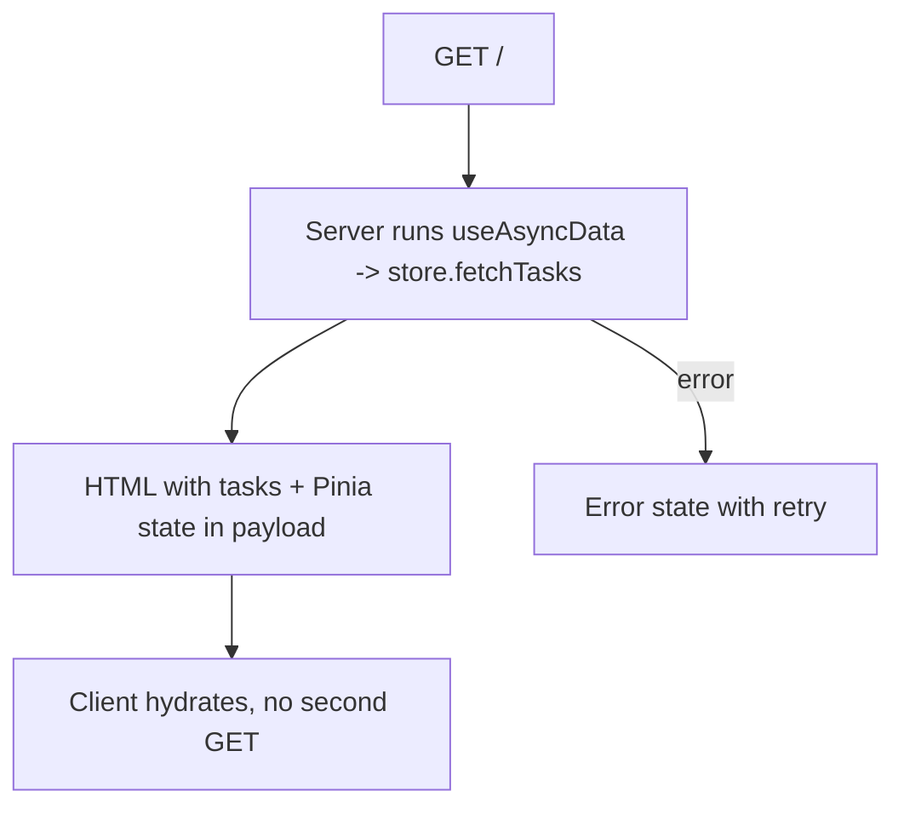
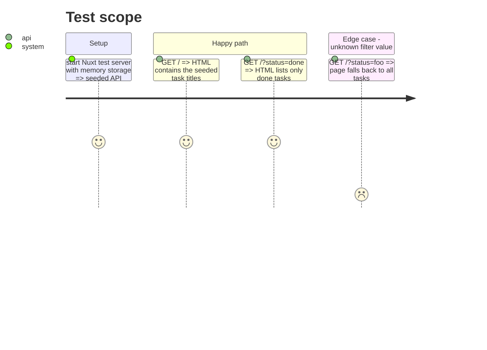

# Instruction: SSR initial load on the home page

## Architecture projection

```txt
.
├── app/
│   ├── app.vue                 ✏️ render <NuxtPage />, page title via useHead
│   └── pages/index.vue         ✅ SSR load via useAsyncData + store, sync filters with route query, minimal list with loading, empty and error states
└── test/e2e/
    └── home-ssr.test.ts        ✅ server-rendered HTML already contains seeded task titles
```

## User Journey



## Test Scope



## Tasks to do

### `1)` Page

> First paint already holds the tasks.

1. `app.vue` renders `<NuxtPage />`.
2. `pages/index.vue`: `await useAsyncData('tasks', () => store.fetchTasks())`, expose error and `refresh` as retry.
3. Read `status` and `priority` from `route.query` (validated against the shared enums, fallback `all`) into the store; write back to the query on change with `router.replace`.
4. Minimal semantic list (title, status, priority) with loading, empty and error states; styling is step 3.

### `2)` SSR test

> Prove the HTML is server-rendered.

1. e2e test with `$fetch('/')` checking task titles in the HTML, with and without a filter query.

## Test acceptance criteria

| Task | Acceptance criteria                                                    |
| ---- | ---------------------------------------------------------------------- |
| 1    | Viewing page source on `/` shows the tasks; no client GET on hydration  |
| 2    | `npm test`, `npm run typecheck` and `npm run build` pass               |
