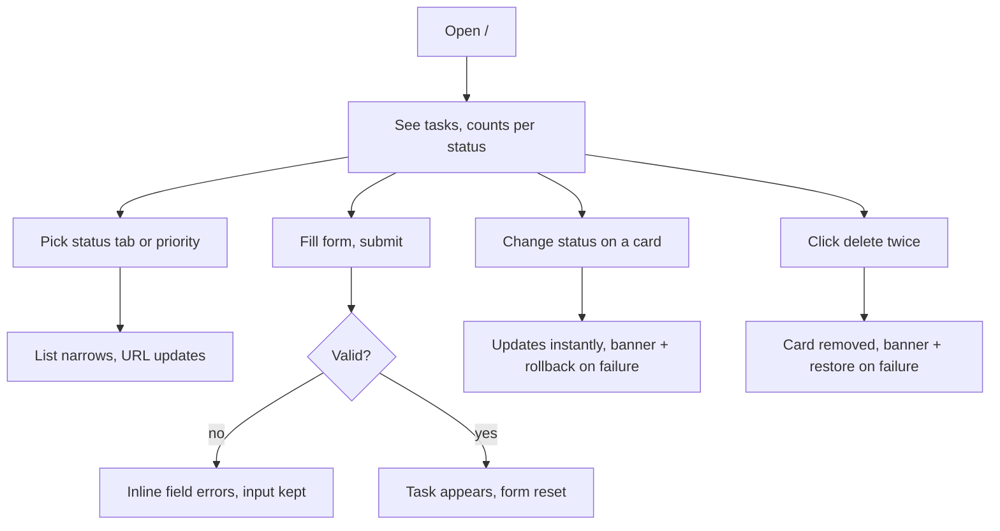
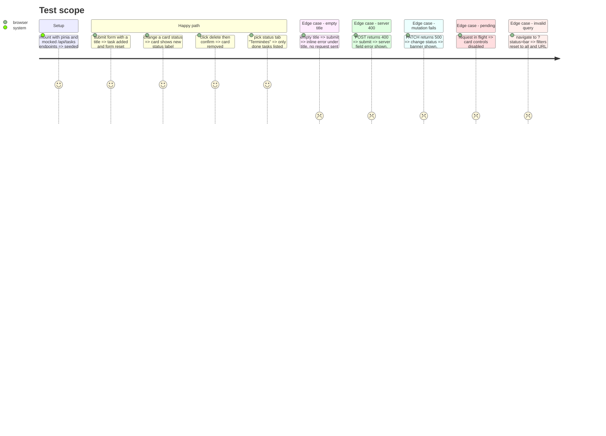

# Instruction: Components and interactions

## Architecture projection

```txt
.
├── app/
│   ├── pages/index.vue                    ✏️ compose the components, wire store actions
│   ├── composables/useTaskFilters.ts      ✅ URL query ⇄ store filters (single immediate watcher, cleans invalid values)
│   ├── utils/task-labels.ts               ✅ French labels for statuses and priorities
│   ├── utils/api-error.ts                 ✏️ `class ApiError extends Error implements ApiErrorState`, one shape
│   └── components/
│       ├── TaskForm.vue                   ✅ create form, client validation with createTaskSchema, field errors, pending state
│       ├── TaskFilters.vue                ✅ status tabs with counts + priority select
│       ├── TaskCard.vue                   ✅ title, description, priority badge, status control, delete (confirm on 2nd click)
│       ├── TaskList.vue                   ✅ loading skeleton, empty state (none vs filtered out), list
│       └── AppAlert.vue                   ✅ dismissible error banner (role="alert") for mutation errors
└── test/
    ├── nuxt/components/*.test.ts          ✅ TaskForm, TaskCard, TaskFilters behaviors
    ├── nuxt/composables/useTaskFilters.test.ts ✅
    └── e2e/home-ssr-corrupted.test.ts     ✏️ remove temp dir in afterAll
```

## User Journey



## Test Scope



## Wireframe

```txt
Desktop (≥ lg)
┌──────────────────────────────────────────────────────────────────────────┐
│ Tâches                                         12 tâches · 4 terminées    │
├──────────────────────┬───────────────────────────────────────────────────┤
│ Nouvelle tâche       │ [Toutes 12][À faire 5][En cours 3][Terminées 4]   │
│ Titre  [__________]  │                         Priorité [Toutes     ▾]   │
│ Description          │ ┌───────────────────────────────────────────────┐ │
│ [________________]   │ │ ● Élevée   Préparer la démo                   │ │
│ Priorité [Moyenne ▾] │ │ Description sur deux lignes max…              │ │
│ Statut   [À faire ▾] │ │ Statut [En cours ▾]                [Supprimer]│ │
│ [ Ajouter la tâche ] │ └───────────────────────────────────────────────┘ │
│ (sticky)             │ ┌───────────────────────────────────────────────┐ │
│                      │ │ ...                                           │ │
└──────────────────────┴───────────────────────────────────────────────────┘
Mobile
┌────────────────────────┐
│ Tâches        12 · 4 ✓ │
│ [+ Nouvelle tâche]     │  ← toggles the form inline
│ ‹Toutes|À faire|En c…› │  ← tabs scroll horizontally
│ Priorité [Toutes ▾]    │
│ ┌────────────────────┐ │
│ │ Élevée             │ │
│ │ Préparer la démo   │ │
│ │ [En cours ▾] [🗑]  │ │
│ └────────────────────┘ │
└────────────────────────┘
⚠ Banner (top, dismissible): « Impossible de mettre à jour la tâche. Modification annulée. »
```

## Tasks to do

### `1)` Filters composable

> URL is the single source for filters.

1. `useTaskFilters()`: one `watch(() => route.query, …, { immediate: true })` parsing with the shared enums, calling `store.setFilters`, and `router.replace` to drop invalid values.
2. Setters (`setStatus`, `setPriority`) only call `router.replace`; no store → URL watcher, no flag.

### `2)` Components

> Small presentational pieces.

1. `TaskForm`: validate with `createTaskSchema` before submit, show client and server `fieldErrors`/`formErrors`, disable while submitting, keep input on failure, reset on success.
2. `TaskFilters`: status tabs (`role="tablist"` or radio group) with counts from `countsByStatus`, priority select.
3. `TaskCard`: status `<select>` labelled, priority badge with text, delete confirm on second click (auto-cancel after a few seconds or on blur), controls disabled when pending.
4. `TaskList`: loading, empty (no task at all vs nothing matching filters, with a reset-filters action), list.
5. `AppAlert`: shows `store.error` for mutations, dismiss calls `clearError`; the create form shows its own errors, so the banner ignores 400s from create to avoid duplicates.

### `3)` Review leftovers

> Close step 2 minor findings.

1. Merge `ApiError` shapes: `class ApiError extends Error implements ApiErrorState`.
2. `afterAll` removes the temp dir in `home-ssr-corrupted.test.ts`.

### `4)` Tests

> Cover the Test Scope with `mountSuspended` and `registerEndpoint`.

## Test acceptance criteria

| Task | Acceptance criteria                                                              |
| ---- | -------------------------------------------------------------------------------- |
| 1    | Back/forward and shared links drive filters; invalid query values are removed     |
| 2    | Every Test Scope line is observable in the rendered component                     |
| 3    | One error shape in `api-error.ts`; no leftover temp dir after tests               |
| 4    | `npm test` and `npm run typecheck` pass                                           |
