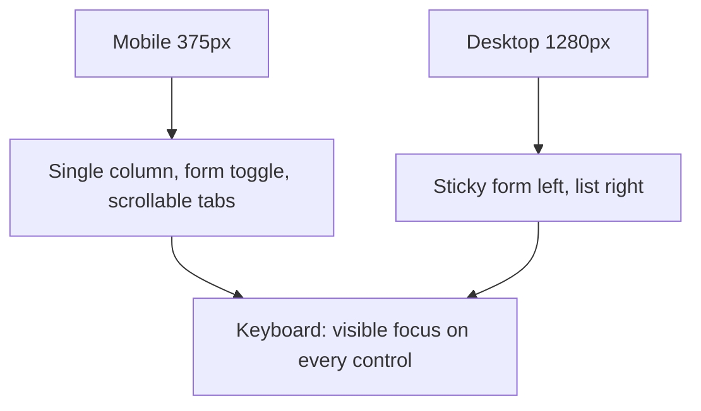
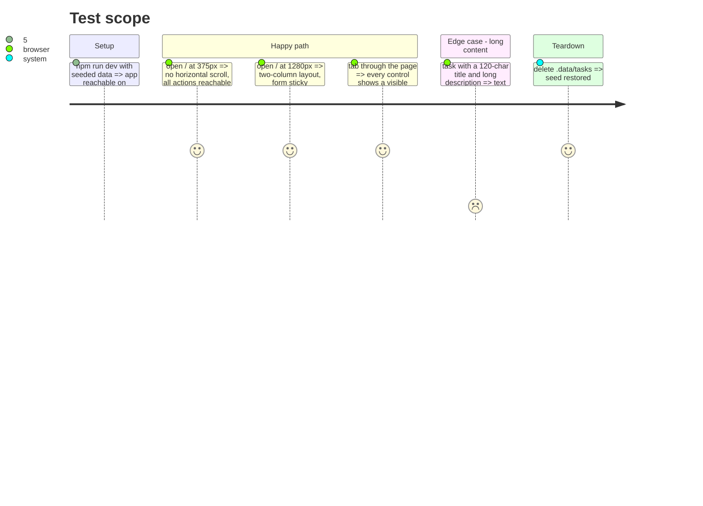

# Instruction: Visual direction, responsive and a11y pass

## Architecture projection

```txt
.
├── app/assets/css/main.css      ✏️ @theme tokens (palette, font, radii) for the chosen direction
├── app/app.vue                  ✏️ html lang="fr", font loading if any, page title
├── app/components/*.vue         ✏️ final Tailwind styling
└── aidd_docs/memory/design.md   ✏️ record the chosen direction and tokens
```

## User Journey



## Test Scope



## Tasks to do

### `1)` Direction

> A calm, precise product UI, not a template.

1. Load the `impeccable` skill (Operate mode) and `frontend-design`; pick a restrained direction with one accent color, a distinctive but readable type pairing, status and priority encoded by label + subtle color.
2. Declare tokens with `@theme` in `main.css`; Tailwind utilities only, no custom CSS beyond tokens.

### `2)` Responsive and a11y

> Works at 375px and 1280px, keyboard and screen reader friendly.

1. Apply the wireframe layouts; tabs scroll horizontally on mobile.
2. `lang="fr"`, labels on every control, focus-visible rings, AA contrast, `aria-live` for the banner.
3. Verify by rendering at 375px and 1280px (screenshots), fix what one look shows, then look again.

### `3)` Memory

> Keep `design.md` true.

1. Record direction, token location and component patterns.

## Test acceptance criteria

| Task | Acceptance criteria                                                       |
| ---- | ------------------------------------------------------------------------- |
| 1    | The UI has a coherent identity with tokens declared once in `main.css`     |
| 2    | No horizontal scroll at 375px; every control reachable and focus-visible  |
| 3    | `design.md` matches the shipped UI; typecheck, tests and build pass        |
